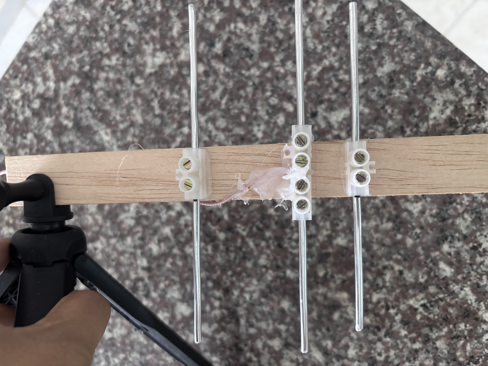
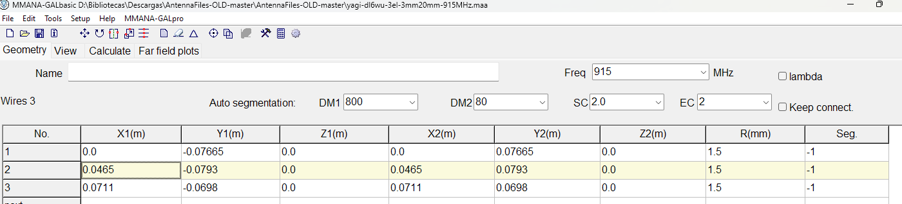
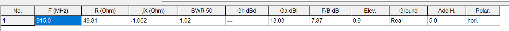
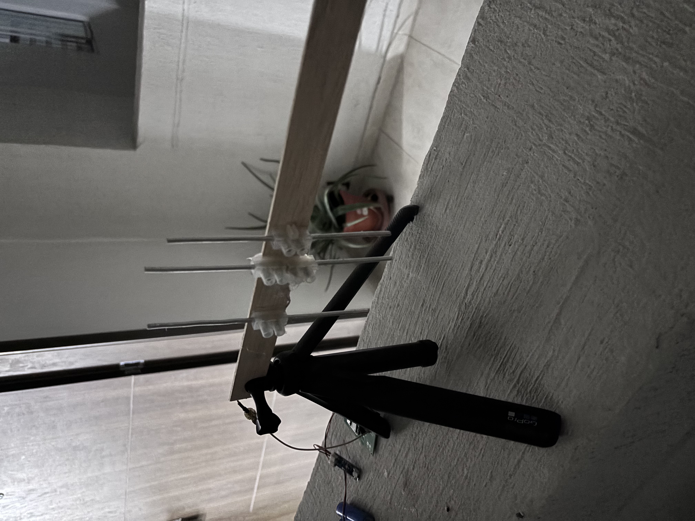
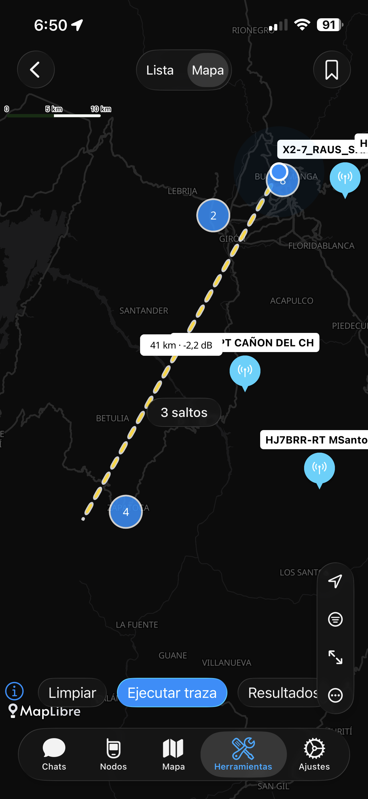

# Yagi 3 Elementos 915 MHz — Homemade para MeshCore

Antena Yagi direccional de 3 elementos (reflector, driven, director) diseñada y construida
de forma casera para operar en 915 MHz sobre la red [MeshCore](https://meshcore.co.uk/), con
el objetivo de mejorar el alcance y la calidad de enlace hacia repetidores distantes de la
red mesh LoRa.

## Resultado

Con esta antena se logró un enlace estable de **41 km en 3 saltos** (ida y vuelta) hasta un repetidor de la
red MeshCore en Santander, Colombia, medido con la app MeshCore One (iphone) en campo (ver sección
[Prueba de campo](#prueba-de-campo)).

## Índice

- [Yagi 3 Elementos 915 MHz — Homemade para MeshCore](#yagi-3-elementos-915-mhz--homemade-para-meshcore)
  - [Resultado](#resultado)
  - [Índice](#índice)
  - [Motivación](#motivación)
  - [Diseño](#diseño)
    - [Dimensiones](#dimensiones)
    - [Nota técnica: ¿por qué el driven es más largo que el reflector?](#nota-técnica-por-qué-el-driven-es-más-largo-que-el-reflector)
  - [Lista de materiales (BOM)](#lista-de-materiales-bom)
    - [Herramientas usadas](#herramientas-usadas)
  - [Construcción](#construcción)
  - [Medición y ajuste](#medición-y-ajuste)
  - [Prueba de campo](#prueba-de-campo)
  - [Tips and tricks](#tips-and-tricks)
  - [Resultados y conclusiones](#resultados-y-conclusiones)
  - [Créditos y licencia](#créditos-y-licencia)

## Motivación

Los nodos MeshCore suelen operar con antenas omnidireccionales, que reparten la energía en
todas direcciones. Para enlaces punto a punto de larga distancia (por ejemplo, alcanzar un
repetidor fijo en la cima de un cerro), una antena direccional como una Yagi concentra la
energía en un lóbulo estrecho, ganando varios dB frente a una omni y permitiendo cerrar
enlaces que de otra forma no serían posibles.

Mi qth está en un valle rodeado de cerros, y la antena omnidireccional del nodo MeshCore me
permitía cerrar enlaces hacia repetidores distantes, pero con muy baja ganancia. Por eso decidí diseñar y construir una Yagi de 3 elementos para mejorar el enlace hacia un repetidor lejano, y documentar el proceso para que otros puedan replicarlo.

Este proyecto documenta el diseño, la construcción y las pruebas de campo de una Yagi de 3
elementos construida con materiales caseros/económicos, pensada para replicarse fácilmente.

## Diseño

El diseño se modeló en **MMANA-GAL** para calcular las longitudes de los elementos, el
espaciado entre ellos y la impedancia esperada en el punto de alimentación, antes de cortar
ningún material.

Modelo: `yagi-dl6wu-3el-3mm20mm-915MHz.maa`

Parámetros de diseño (simulación a 915 MHz, tierra real, altura 5 m):

| Parámetro              | Valor                         |
|-------------------------|--------------------------------|
| Frecuencia de diseño     | 915 MHz                        |
| Elementos                | 3 (reflector, driven, director) |
| Ganancia (Ga)             | 13.03 dBi *(con tierra real, altura 5 m)* |
| Relación F/B               | 7.87 dB                        |
| Impedancia del driven        | 49.81 Ω, jX = -1.062 Ω         |
| SWR (50 Ω)                     | 1.02                           |
| Ángulo de elevación               | 0.9°                           |
| Polarización                        | Horizontal                     |

Geometría del modelo (tabla *Wires* de MMANA-GAL) y resultado de la simulación:

> El archivo del modelo (`.maa`) y estas capturas están en [`model/`](model/).

### Dimensiones

Diámetro de varilla usado en todos los elementos: **3 mm** (radio 1.5 mm en el modelo).

| Elemento   | Longitud | Posición en el boom (X) | Espaciado respecto al anterior |
|------------|----------|---------------------------|----------------------------------|
| Reflector  | 153.3 mm | 0 mm (referencia)         | —                                  |
| Driven     | 158.6 mm | 46.5 mm                    | 46.5 mm                            |
| Director   | 139.6 mm | 71.1 mm                     | 24.6 mm                            |

Boom total (reflector a director): **71.1 mm**.

### Nota técnica: ¿por qué el driven es más largo que el reflector?

A simple vista las longitudes de esta antena rompen la regla de dedo clásica de una Yagi
(reflector más largo que el driven, driven más largo que el director): aquí el **driven
(158.6 mm) es incluso más largo que el reflector (153.3 mm)**. Esto no es un error del
modelo ni de la medición; tiene una explicación técnica:

1. **Es un diseño optimizado por NEC (Método de los Momentos), no calculado con fórmulas
   clásicas.** Las reglas de dedo tradicionales (reflector ~5% más largo que el driven
   resonante, director ~5% más corto) asumen espaciados "de libro" (~0.15–0.25λ) en espacio
   libre. MMANA-GAL resuelve la corriente real sobre cada elemento considerando el
   acoplamiento mutuo entre ellos, en vez de aplicar esas fórmulas. Cuando el optimizador
   ajusta longitudes para cumplir un objetivo (SWR bajo, ganancia, F/B), puede llegar a
   proporciones que no siguen la jerarquía clásica, siempre que el resultado
   electromagnético sea correcto.

2. **El espaciado de este diseño es inusualmente compacto**, lo que intensifica el efecto
   anterior:
   - Reflector → driven: 46.5 mm (~0.14λ a 915 MHz)
   - Driven → director: solo 24.6 mm (~0.075λ)
   - Boom total: 71.1 mm (~0.22λ)

   Con el director a menos de 0.08λ del driven, el acoplamiento mutuo es mucho más fuerte
   que en una Yagi de boom largo. Esa reactancia mutua "carga" eléctricamente al driven, y
   para que siga resonando cerca de 50 Ω reales el optimizador necesita compensar
   alargándolo, incluso por encima del reflector — un comportamiento típico de diseños
   *short-boom / close-spaced*.

3. **La evidencia de que el diseño es correcto está en los propios resultados de la
   simulación**: SWR de 1.02:50 Ω, F/B de 7.87 dB y ganancia de 13.03 dBi (con tierra real a
   5 m) no son números casuales, sino la señal de que el modelo converge a una solución
   físicamente válida, aunque no respete la heurística de "el reflector siempre es el
   elemento más largo".

## Lista de materiales (BOM)

| Ítem | Descripción | Cantidad | Costo aprox. | Dónde conseguirlo |
|------|-------------|----------|----------------|---------------------|
| Boom | Listón de madera balsa/pino | 1 | 5000 COP | Panamericana |
| Elementos | Varilla de aluminio/acero | 3 | 10000 COP (6metros) | ferretería |
| Conectores driven | Borneras de conexión rápida | 4 |5000 COP | ferretería |
| Cable coaxial | RG-316 / pigtail | 1 | 2000 COP | Aliexpress |
| Conector RF | SMA / U.FL según el módulo | 1 | 3000 COP | Aliexpress |
| Pistola de silicona + barras | Para fijación y sellado | — | | |

*(Completar cantidades, medidas de la varilla y costos reales del proyecto.)*

### Herramientas usadas

- Pistola de silicona caliente
- Cortafrío / cizalla para las varillas
- Multímetro (continuidad)
- *(Se requiere NanoVNA)*

## Construcción

Ensamblaje de los tres elementos sobre el boom, con las borneras de conexión rápida
sosteniendo cada varilla y el punto de alimentación del driven soldado y sellado con
silicona caliente:

Pasos generales:

1. Cortar los tres elementos (reflector, driven, director) según las medidas del modelo.
2. Marcar sobre el boom las posiciones exactas de cada elemento.
3. Fijar reflector y director con las borneras, pasando la varilla completa a través del boom.
4. Preparar el punto de alimentación del driven: pelar el coaxial, soldar vivo y malla a cada
   mitad del elemento.
5. Sellar la soldadura del driven con silicona caliente para protegerla de la intemperie y
   darle rigidez mecánica al punto más frágil de la antena.
6. Verificar continuidad y aislamiento con el multímetro antes de conectar el equipo.

## Medición y ajuste

*(Agregar aquí el SWR medido con analizador de antenas si se tomó esa medición, para
comparar contra el valor simulado en MMANA-GAL.)*

| Frecuencia | SWR modelado | SWR medido |
|------------|--------------|-------------|
| 915 MHz    | 1.02         |   1.25          |

## Prueba de campo

Traza de enlace en la app **MeshCore One**, mostrando el path hacia un repetidor remoto:

- **Distancia del salto marcado:** 41 km
- **Señal del salto:** -2,2 dB
- **Saltos totales hasta el repetidor:** 3

Este resultado confirma que la ganancia y directividad de la Yagi permiten cerrar enlaces de
larga distancia hacia repetidores de la red MeshCore en la región de Santander, Colombia.

## Tips and tricks

*(Completar con los tips propios del proceso — algunos ejemplos de lo que suele documentarse
en este tipo de builds:)*

- *Primero consiga el alambre para el dipolo antes de comprar las borneras. Compre las borneras que mejor se ajusten al diametro del cable. Nunca al revez*
- *Primero constuir el dipolo con el pigtail y dos borneras, una para cada extremo*
- *La bornera puede cortar el coaxial. Agregar una gota de soldadura de estano ayuda a evitarlo*
- *Utilice medidas superiores para el dipolo a fin de cortarlos y ajustalo con el vna*
- *El director y el flector pueden ser cortados a medida, pero el dipolo debe ser ajustado con el vna*
- *Use siempre el nanoVNA para medir el SWR y ajustar el dipolo. No confie en las medidas de MMANA-GAL*
- *Calibre el nanoVNA antes de medir el SWR, yo uso 850Mhz a 950Mhz para calibrar (cortando el dipolo) y luego mido el SWR en 915Mhz con span de 10Mhz*
- *Desarme el dipolo y corte los extremos hasta que el SWR sea menor a 1.5 (repita el proceso)*
- *Una vez terminado el ensamblaje, verificar la continuidad y aislamiento con el multímetro*
- *Los brazos del dipolo deben estar lo mas cerca posible entre ellos, sin hacer cortocircuito*
- *Corte siempre los elementos con sierra , mantenga un corte a 90 grados. Ayudese con una lija para pulir las superficies*

## Resultados y conclusiones

- Enlace de 41 km logrado en campo con 3 saltos hasta el repetidor objetivo.
- *(Agregar qué funcionó bien y qué se mejoraría en una v2: material del boom, protección
  contra intemperie, ajuste fino del SWR, etc.)*

## Créditos y licencia

- Diseño y construcción: Roman ([HJ7RMN](https://www.qrz.com/)) 
- Red: [MeshCore](https://meshcore.io/)
- Modelado de antena: [MMANA-GAL](http://mmhamsoft.amateur-radio.ca/mmana-gal/)

Documentación bajo licencia [CC BY 4.0](https://creativecommons.org/licenses/by/4.0/).
Diseño de hardware bajo licencia [CERN-OHL-P](https://cern-ohl.web.cern.ch/) (o la que
prefieras aplicar).
